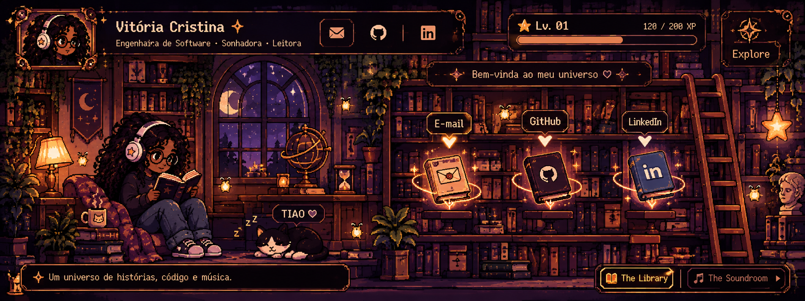

# Your Little Universe ✦

Um portfólio em pixel art com duas dimensões: **The Library** e **The Soundroom**.

## Como publicar
1. Edite `index.html` e troque `SEU-USUARIO`, `SEU-EMAIL` e `SEU-LINKEDIN` pelos seus dados.
2. Envie todos os arquivos deste projeto para a raiz do repositório do GitHub.
3. Abra **Settings → Pages**.
4. Em **Build and deployment**, escolha **Deploy from a branch**.
5. Selecione a branch `main` e a pasta `/ (root)`, depois clique em **Save**.
6. Aguarde a publicação. O GitHub mostrará o endereço do site em Settings → Pages.

## Personalização
- `style.css`: cores, tamanhos e animações.
- `script.js`: comportamento dos livros e troca de dimensões.
- `assets/`: imagens das cenas.

> A versão atual é uma primeira base funcional. A arte de referência está incorporada como imagem de fundo; os hotspots e efeitos são camadas interativas sobre ela. Para animar a personagem virando páginas de forma fiel, o próximo passo será criar sprites pixel-art separados da personagem e do TIAO.
